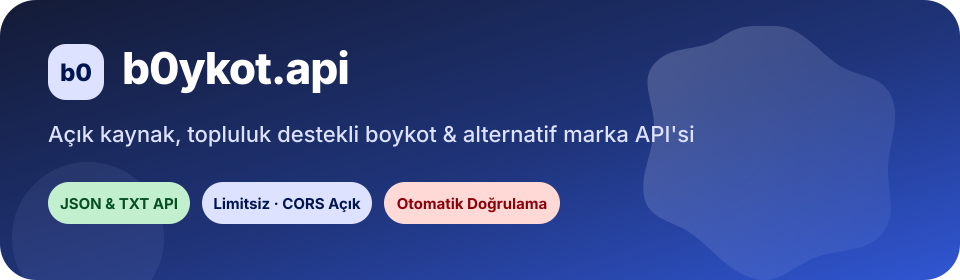

<div align="center">



<br/><br/>

<p align="center">
  <a href="https://hasanbkaylan.github.io/b0ykot.api/">
    
  </a>
  <a href="LICENSE">
    
  </a>
  <a href="https://github.com/hasanbkaylan/b0ykot.api/issues/new/choose">
    
  </a>
</p>

</div>

> [!IMPORTANT]
> **Bu proje Filistin'i desteklemektedir.**
> Kök dizindeki `boykot.txt` ve `boykotdegil.txt` dosyaları her güncellemede GitHub Actions tarafından otomatik olarak klonlardan arındırılır, sıralanır ve ücretsiz Statik JSON/TXT API olarak yayınlanır.

---

## Hızlı Bakış

- **Canlı Arama & Geçmiş:** [hasanbkaylan.github.io/b0ykot.api](https://hasanbkaylan.github.io/b0ykot.api/) üzerinden anında marka arayabilir, **Geçmiş** butonundan tarih tarih eklenen/çıkarılan markaları inceleyebilirsiniz.
- **Sıfır Kurulum & CORS Dostu:** API anahtarı (API Key) ve rate limit olmadan tarayıcıdan, mobil uygulamadan veya backend'den doğrudan çekilebilir.
- **Akıllı Yazım Eşleştirme:** Market sitelerindeki `Nestlé` / `Nestle`, `Burger King` / `Burger-King`, `Çaykur` / `Caykur` farklarını otomatik yakalar.

---

<details open>
<summary><b>📡 API Uç Noktaları (Endpoints)</b></summary>

<br/>

**Ana Adres:** `https://hasanbkaylan.github.io/b0ykot.api`

| Format | Yol |
| :--- | :--- |
| **JSON** *(Önerilen)* | [`/v1/lookup.json`](https://hasanbkaylan.github.io/b0ykot.api/v1/lookup.json) |
| **JSON** *(Tüm Veri)* | [`/v1/all.json`](https://hasanbkaylan.github.io/b0ykot.api/v1/all.json) |
| **JSON** *(Geçmiş)* | [`/v1/history.json`](https://hasanbkaylan.github.io/b0ykot.api/v1/history.json) |
| **JSON** *(Boykot)* | [`/v1/boykot.json`](https://hasanbkaylan.github.io/b0ykot.api/v1/boykot.json) |
| **JSON** *(Boykot Değil)* | [`/v1/boykotdegil.json`](https://hasanbkaylan.github.io/b0ykot.api/v1/boykotdegil.json) |
| **TXT** *(Temiz Boykot)* | [`/boykot.txt`](https://hasanbkaylan.github.io/b0ykot.api/boykot.txt) |
| **TXT** *(Temiz Boykot Değil)* | [`/boykotdegil.txt`](https://hasanbkaylan.github.io/b0ykot.api/boykotdegil.txt) |
| **TXT** *(Varyasyonlu Boykot)* | [`/v1/boykot-variants.txt`](https://hasanbkaylan.github.io/b0ykot.api/v1/boykot-variants.txt) |
| **TXT** *(Varyasyonlu Boykot Değil)* | [`/v1/boykotdegil-variants.txt`](https://hasanbkaylan.github.io/b0ykot.api/v1/boykotdegil-variants.txt) |

</details>

---

<details>
<summary><b>🤖 Yapay Zeka Asistanı İçin Hazır Entegrasyon & Güncelleme Promptu</b></summary>

<br/>

> [!TIP]
> Kendi uygulamanıza (Flutter, React, Next.js, Kotlin, Swift, Python, Chrome Eklentisi vb.) **b0ykot.api** desteğini eklemek veya mevcut entegrasyonu güncellemek için aşağıdaki promptu kopyalayıp yapay zeka asistanınıza (ChatGPT, Claude, Gemini, Cursor vb.) yapıştırın.

```text
Projeme "b0ykot.api" açık kaynak boykot marka listesi API'sini entegre et (veya mevcut entegrasyonu buna göre güncelle):

1. Veri Kaynakları (CORS açık, API Key gerektirmez):
   - Hızlı sorgulama sözlüğü: https://hasanbkaylan.github.io/b0ykot.api/v1/lookup.json
   - Tüm listeler, toplam sayılar ve son güncelleme tarihi: https://hasanbkaylan.github.io/b0ykot.api/v1/all.json
   - Değişiklik geçmişi (tarih tarih eklenen/çıkarılanlar): https://hasanbkaylan.github.io/b0ykot.api/v1/history.json

2. JSON Yapıları:
   - lookup.json formatı:
     {
       "nestle": { "name": "Nestlé", "status": "boykot" },
       "caykur": { "name": "Çaykur", "status": "boykot_degil" }
     }
   - all.json formatı:
     {
       "updated_at": "ISO-8601-UTC",
       "counts": { "boykot": 132, "boykot_degil": 71 },
       "boykot": ["..."],
       "boykot_degil": ["..."]
     }

3. Marka Eşleştirme (Normalizasyon) Kuralı:
   Marka adını sorgulamadan önce şu adımlarla normalize et:
   - Türkçe/aksanlı karakterleri dönüştür: ç->c, ğ->g, ı->i, İ->i, I->i, ö->o, ş->s, ü->u, é->e
   - Küçük harfe çevir, Unicode NFKD ile kalan aksanları temizle
   - Harf ve rakam dışındaki tüm karakterleri (boşluk, tire, kesme işareti vb.) sil: [^a-z0-9]
   - Örnek: "Burger King" -> "burgerking", "NESTLÉ" -> "nestle", "Domino’s" -> "dominos"
   - Ardından lookup[normalizedKey] ile anında sorgula.

4. Performans ve Güncelleme Davranışı:
   - Uygulama açılışında veya belirli aralıklarla veriyi çek ve yerel önbellekte (localStorage / SharedPreferences / SQLite / cache) sakla; çevrimdışı durumda önbellekten çalışmaya devam et.
   - all.json içindeki "updated_at" alanını kontrol ederek yalnızca yeni güncelleme olduğunda yerel veriyi yenile.
```

</details>

---

<details>
<summary><b>💻 Kod Örnekleri (JavaScript & Python)</b></summary>

<br/>

<p>
  
</p>

```javascript
const trMap = {
  "ç": "c", "Ç": "c", "ğ": "g", "Ğ": "g", "ı": "i", "İ": "i",
  "I": "i", "ö": "o", "Ö": "o", "ş": "s", "Ş": "s", "ü": "u", "Ü": "u", "é": "e", "É": "e"
};

const normalize = (text) =>
  text
    .replace(/[çÇğĞıİIöÖşŞüÜéÉ]/g, (ch) => trMap[ch] || ch)
    .toLowerCase()
    .normalize("NFKD")
    .replace(/[\u0300-\u036f]/g, "")
    .replace(/[^a-z0-9]/g, "");

const res = await fetch("https://hasanbkaylan.github.io/b0ykot.api/v1/lookup.json");
const lookup = await res.json();

console.log(lookup[normalize("NESTLÉ")]);
// { name: "Nestlé", status: "boykot" }
```

<p>
  
</p>

```python
import re
import unicodedata
import requests

TR_MAP = str.maketrans({
    "ç": "c", "Ç": "c", "ğ": "g", "Ğ": "g", "ı": "i", "İ": "i",
    "I": "i", "ö": "o", "Ö": "o", "ş": "s", "Ş": "s", "ü": "u", "Ü": "u", "é": "e", "É": "e"
})

def normalize(text: str) -> str:
    text = text.translate(TR_MAP).lower()
    text = unicodedata.normalize("NFKD", text)
    text = "".join(c for c in text if not unicodedata.combining(c))
    return re.sub(r"[^a-z0-9]", "", text)

lookup = requests.get("https://hasanbkaylan.github.io/b0ykot.api/v1/lookup.json").json()
print(lookup.get(normalize("Çaykur")))
# {'name': 'Çaykur', 'status': 'boykot_degil'}
```

</details>

---

<details>
<summary><b>🤝 Katkıda Bulunma ve Lisans</b></summary>

<br/>

- Listeye yeni marka eklemek veya düzeltme bildirmek için [Katkıda Bulunma Rehberi](CONTRIBUTING.md) dosyasını okuyabilir ya da doğrudan [Marka Öneri Formu](https://github.com/hasanbkaylan/b0ykot.api/issues/new/choose) üzerinden talep oluşturabilirsiniz.
- Geliştirici: **Hasan Berat Kaylan** ([@hasanbkaylan](https://github.com/hasanbkaylan))
- Bu proje [MIT Lisansı](LICENSE) altında lisanslanmıştır.

<p>
  <a href="https://github.com/hasanbkaylan/b0ykot.api">
    
  </a>
  <a href="LICENSE">
    
  </a>
</p>

</details>
